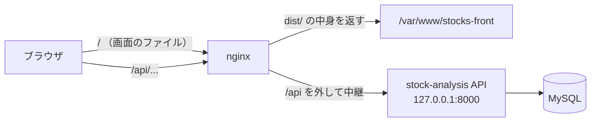

# 本番への配置

stocks-front を、stock-analysis と同じVPSに置くための手順です。**手順と設定例までが対象で、実機での実行は未実施**です。実行して詰まったところは、この文書を直します。

関連: stock-analysis の [docs/deploy.md](https://github.com/mstm09/stock-analysis/blob/develop/docs/deploy.md)（VPSの構築、APIの常駐）

## 1. しくみ



- `npm run build` を実行すると、`dist/` に、ブラウザがそのまま読めるファイル（HTML・JavaScript・CSS）ができる。本番では、Node.js を動かし続ける必要はない。nginx がファイルを配るだけ。
- 画面は `/api/...` を呼ぶ。nginx が、同じサーバーで動くAPI（`127.0.0.1:8000`）へ中継する。ブラウザから見ると同じ場所なので、CORSの設定はいらない。
- APIは外に公開しない（`127.0.0.1` だけで待ち受ける）。外から届くのは nginx だけ。

## 2. 前提（先に済ませること）

| 課題 | 内容 |
| :-- | :-- |
| PY-19 | 本番VPSの構築。APIが `systemd` で動いている |
| PY-21 | アクセス制限の方式（WireGuard / Tailscale / IP制限）。**これを決めるまで、nginx を外に向けて開けない** |

売買記録の画面は、DBに書き込む。誰でも開ける状態にしないこと。

## 3. 手で置く（最初の1回）

1. 手元でビルドする。

   ```bash
   npm ci
   npm run build
   ```

2. VPSに nginx を入れ、置き場所を作る。

   ```bash
   sudo apt install -y nginx
   sudo mkdir -p /var/www/stocks-front
   sudo chown （一般ユーザー）: /var/www/stocks-front
   ```

3. `dist/` の中身を送る（手元から）。

   ```bash
   rsync -av --delete dist/ （一般ユーザー）@（VPS）:/var/www/stocks-front/
   ```

4. nginx の設定を置く。[deploy/nginx.conf.example](../deploy/nginx.conf.example) を元にする。

   ```bash
   sudo cp nginx.conf.example /etc/nginx/sites-available/stocks-front
   sudo ln -s /etc/nginx/sites-available/stocks-front /etc/nginx/sites-enabled/
   sudo rm /etc/nginx/sites-enabled/default
   sudo nginx -t && sudo systemctl reload nginx
   ```

5. 確かめる。

   - 許可したマシンのブラウザで、画面が開く。
   - ホームの「APIとの接続」が「つながっています」になる。
   - `/candidates` を**直接**開いても（再読み込みしても）、画面が出る（`try_files` の確認）。
   - 許可していないマシンからは、開けない。

## 4. トークン（API_TOKEN）を使う場合

- stock-analysis 側で `API_TOKEN` を設定したら、nginx の `location /api/` で `Authorization` ヘッダーを付ける（設定例のコメントを外す）。
- **`VITE_API_TOKEN` は、本番のビルドでは使わない**。ビルド結果に埋め込まれ、ブラウザから誰でも読めるため（開発用）。
- チャート画像は、画面が `fetch` で取ってから表示している（`` は `Authorization` ヘッダーを送れないため）。nginx でヘッダーを付ける方式でも、そのまま動く。

## 5. CircleCIで自動で置く（案）

`master` にマージしたら、ビルドして rsync で送る。stock-analysis の `deploy` と同じ考え方。**未検証のため、`.circleci/config.yml` にはまだ入れていない**。PY-20（stock-analysis の自動デプロイ）が動いてから、同じ鍵と環境変数で足す。

```yaml
  deploy:
    docker:
      - image: cimg/node:lts
    steps:
      - checkout
      - run: npm ci
      - run: npm run build
      - add_ssh_keys:
          fingerprints:
            - "${DEPLOY_SSH_FINGERPRINT}"
      - run:
          name: サーバーへ送る
          # DEPLOY_HOST / DEPLOY_USER は CircleCI の環境変数に入れる
          command: |
            sudo apt-get update && sudo apt-get install -y rsync
            rsync -av --delete -e "ssh -o StrictHostKeyChecking=accept-new" \
              dist/ "$DEPLOY_USER@$DEPLOY_HOST:/var/www/stocks-front/"
```

```yaml
workflows:
  main:
    jobs:
      - test
      - deploy:
          requires: [test]
          filters:
            branches:
              only: master
```

- VPN（PY-21）を入れると、CircleCIからVPSへSSHが届かなくなる可能性がある。その場合の経路は、stock-analysis 側（PY-20、PY-21）と合わせて決める。

## 6. 未決事項

- [ ] アクセス制限の方式（PY-21）と、nginx の `listen` の書き方
- [ ] HTTPSにするか（VPNの中だけなら、HTTPのままでも通信は暗号化される。外に出すなら必須）
- [ ] CircleCIからの配置の経路
